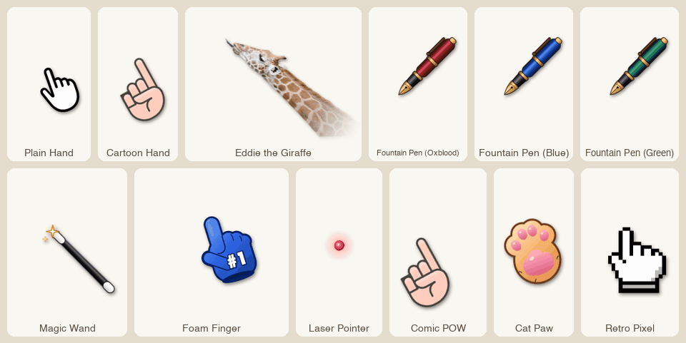

<p align="center"></p>

# TapHand

A tiny macOS menu bar app that makes your pointer read clearly in screen recordings and demos. While it's on,
a pointing hand follows the pointer and visibly "taps" (it presses in, tilts and sends out a ripple) every time
you click. It's a self-built, offline take on the tapping feature of other cursor tools, with the fewest permissions possible.

## Download

**To download this and start tapping:** grab
**[TapHand-1.0.zip](https://github.com/richardkaufmann/tappinghands/releases/download/v1.0/TapHand-1.0.zip)**
(signed with Developer ID and notarized by Apple; macOS 14 or later), unzip it, drag **TapHand.app** into
Applications and open it. A hand icon appears in your menu bar: pick a theme, set the size, and click away.
To start it at login, add it under System Settings › General › Login Items.
All versions: [Releases](https://github.com/richardkaufmann/tappinghands/releases).

<p align="center"></p>

## Meet Eddie the Giraffe

Eddie is a **Rothschild’s giraffe** (*Giraffa camelopardalis rothschildi*, also classified under the northern giraffe). He is well-known at the Nairobi Giraffe Centre (run by the African Fund for Endangered Wildlife) as a prominent member of their breeding herd.

To support the center's conservation and education programs, you can direct contributions through the [Giraffe Centre Fundraise Page](https://www.giraffecentre.org/fundraise/), which outlines direct bank transfer details, M-Pesa channels, and ways to sponsor local school conservation trips.

## Build and run

You need macOS 14 or later and Xcode (or the Xcode Command Line Tools) with Swift 5.10 or newer.

```bash
./build.sh                 # swift build -c release, then wraps the binary in build/TapHand.app (ad-hoc signed)
open build/TapHand.app
```

**Install (opens at login):** `tools/install.sh` builds, copies the app to `/Applications/TapHand.app` and adds a
per-user LaunchAgent (`~/Library/LaunchAgents/local.taphand.plist`, runs `open -a` at login). Re-run it after changes
to update the installed copy; `tools/install.sh --uninstall` removes both (settings are kept).

**Release build (maintainers):** `tools/release.sh [--publish]` signs with Developer ID (hardened runtime), notarizes,
staples and zips to `dist/`; `--publish` attaches it to a GitHub release. One-time notary setup is in the script header.

A hand icon appears in the menu bar. There's no Dock icon and no window. To launch it at login, add
`build/TapHand.app` under System Settings › General › Login Items. To get rid of it, choose Quit and
delete the app. Its settings live in `~/Library/Preferences/local.taphand.plist`.

Optional asset check (renders the hand and its pressed states to PNGs, no screen capture needed):

```bash
build/TapHand.app/Contents/MacOS/TapHand --render-frames docs/frames
```

## Menu

| Item | What it does |
|---|---|
| Show Tapping Hand | Turns the overlay on or off. |
| Theme › … | Pointer art + click effect (see Themes below). |
| Size slider | Pointer size, 24–128 pt, applied live while you drag. |
| Tap Intensity › Subtle / Normal / Expressive | How far the pointer presses in and tilts, how big the click effect gets, and how bouncy the release is. |
| Presentation Mode (clicks don't reach apps) | Shows the tap but stops the click from reaching apps. See below. |
| Hide System Cursor (private API) | Off by default. Hides the real arrow so only the hand shows. See below. |
| About TapHand… | Version, a short description, and Eddie the Giraffe's story with a link to the Giraffe Centre. |
| Quit TapHand | Quits. |

Right clicks always use a second colour (or variant) of the theme's effect.

### Themes

| Theme | Art | Click effect |
|---|---|---|
| Plain Hand (default) | SF Symbol `hand.point.up.left` | blue ring / orange double ring |
| Cartoon Hand | Streamline Emojis "Index pointing up 2" (see credits), tilted up-left | rings |
| Eddie the Giraffe | Richard's photo cut-out: flipped so the tongue tip is the hotspot, tongue + edges cleaned, neck faded (`tools/make_giraffe.py`) | his pink tongue shoots out of his mouth past the click point and snaps back / floating hearts |
| Fountain Pen (Oxblood / Blue / Green) | vector, nib on the hotspot | ink splat |
| Magic Wand | vector | star burst |
| Foam Finger | vector | confetti |
| Laser Pointer | vector red dot | flash ring |
| Comic POW | Cartoon Hand | comic starburst with rotating words |
| Cat Paw | vector | paw-print stamp |
| Retro Pixel | 16×18 pixel art | stepped pixel squares |

Vector art lives in `PointerArt.swift`, effects in `Effects.swift` (each effect is a pure function of time, so
`--render-themes` stills match the live animation). Embedded art is generated into `EmbeddedArt.swift` by
`tools/embed_art.py`, because `build.sh` ships only the binary. Review sheet:
`build/TapHand.app/Contents/MacOS/TapHand --render-themes /tmp/sheet`.

### Custom cursors

Any PNG, SVG or PDF in `~/Library/Application Support/TapHand/Cursors/` shows up under **Theme ▸ Custom**
(menu: *Open Custom Cursors Folder…*, *Reload Custom Cursors*). SVG/PDF stay vector at every size. An optional
sidecar `<name>.json` sets things up (all keys optional):

```json
{ "title": "My Cursor", "hotspot": [9, 2], "size": 54, "effect": "rings", "tilts": true }
```

- `hotspot`: click point in image units (pixels for PNG, points for SVG/PDF) from the top-left; default = the
  opaque pixel nearest the top-left (right for anything pointing up-left).
- `size`: how many image units equal the Size slider; default = the image height.
- `effect`: `rings`, `inkSplat`, `stars`, `confetti`, `laserFlash`, `comicBurst`, `pawPrint`, `pixelRipple`, `lick`.

The README demo animation is rendered by the app too: `tools/make_demo_gif.py` writes `docs/taphand-demo.gif`.

The app icon (blue fountain pen) is drawn by the same code: `tools/make_icon.sh` regenerates `Support/AppIcon.icns`.

## How it works

- **Overlay:** each display gets one borderless, transparent `NSPanel` (`.nonactivatingPanel`, `ignoresMouseEvents = true`,
  `canBecomeKey/Main = false`). It sits at the assistive-tech-high window level and joins all Spaces with
  `.canJoinAllSpaces + .fullScreenAuxiliary + .stationary`, so it shows above menus, the Dock and full-screen apps.
  The app runs as an accessory (`LSUIElement`), so it never takes focus. Screens are rebuilt when displays change.
- **Following the pointer:** each overlay's `CADisplayLink` reads `NSEvent.mouseLocation` once per display refresh
  (in `.common` run loop mode, so it keeps going while menus are open). That matches the display's refresh rate, and
  polling the pointer position needs no permission at all.
- **Detecting clicks:** `NSEvent.addGlobalMonitorForEvents` and `addLocalMonitorForEvents`, for left/right mouse
  down/up **only**. No keyboard events, no scroll events, no movement events. A monitor only *observes*
  events. It can't change or block them, so clicks always reach the app underneath. Very short clicks
  (trackpad tap-to-click can be about 5 ms) still hold the pressed pose for a minimum time so they show up in recordings.
- **Hand artwork:** the built-in SF Symbol `hand.point.up.left` (white fill, black outline, soft shadow). At startup
  the app finds the fingertip pixel and pins it exactly to the pointer's hotspot. The press animation scales and
  rotates around the fingertip, so the finger stays on the click point.

### The real cursor (public API by default)

macOS only lets the frontmost app hide the cursor, and a menu bar app is never frontmost. So by default
TapHand **does not hide the arrow**. It draws the hand so the arrow's tip sits on the fingertip. You see a
small arrow pointing at a hand pointing at the same spot. That reads fine in recordings, and it uses only public API.

**Hide System Cursor (private API)** is an opt-in setting that uses the well-known undocumented WindowServer
property `SetsCursorInBackground` (through `CGSSetConnectionProperty`) together with `CGDisplayHideCursor`. Tradeoffs:

- It's private API. Any macOS update could break it, and it would never pass App Store review. The symbols are
  looked up at runtime with `dlsym`. If they're missing, the menu item is greyed out and the app keeps working.
- When another app becomes active, macOS shows the cursor again. TapHand hides it again on every app switch,
  but a few apps that set their own cursor may briefly flash the arrow.
- It's safe to fail: the hide belongs to TapHand's WindowServer connection. Quitting, turning it off, or a crash
  brings the arrow back.

All of that lives in `Sources/TapHand/CursorHider.swift`.

### Presentation mode

Blocking a click normally takes a `CGEventTap`, which needs the Accessibility permission. TapHand avoids that.
Presentation mode adds a second, nearly invisible panel per screen that *accepts* mouse clicks, so clicks land on
TapHand's panel and go nowhere. That panel is also non-activating, so the frontmost app keeps keyboard focus. It sits
one level **below the menu bar**, so the menu bar and TapHand's own menu stay clickable, which is how you turn the mode off.
Limits, all by design:
- The menu bar still receives clicks.
- Scroll gestures also stop reaching apps while it's on.
- Keyboard input still goes to the front app, because TapHand never reads the keyboard.

## Permissions and privacy

| Permission | Triggered? | Why |
|---|---|---|
| Accessibility | **No** | Mouse-button global monitors don't need it. No event taps, no posting events. |
| Input Monitoring | **No** | No keyboard monitoring of any kind. No `CGEventTap`/IOHID. |
| Screen Recording | **No** | It never captures the screen. It only draws its own windows. |
| Network | **No** | No networking code or frameworks are linked, and there are no entitlements. |
| Anything else (camera, mic, files, contacts…) | **No** | |

macOS shows no permission prompt when TapHand launches or runs. The only state stored is the menu settings in UserDefaults.
Because the build is ad-hoc signed (not notarized), it runs as-is on the Mac that built it. Copying it to another
Mac means right-click › Open the first time.

## Verification done

On macOS 27.3, on a single 4K display:
- Hand drawn live at the pointer, fingertip under the arrow's tip, following a scripted pointer glide.
- Real (synthesized) left clicks on another app's window: the hand presses and ripples, and the window **received both
  clicks**, including a 5 ms tap-to-click-style click.
- Presentation mode: the hand still taps, and the target window received **0** clicks.
- Hide System Cursor: the arrow is gone from screen captures and only the hand shows. The arrow comes back after quitting.
- No permission prompts appeared, and no networking frameworks are linked.

Not verified: multiple displays, display hot-plugging, and full-screen apps or Spaces switching. The code path is
the same per-screen panel with full-screen-auxiliary behavior, but it wasn't exercised. Not checked in OBS
either: OBS's display capture should record the overlay, since its windows use the default sharing type.

## Files

```
Sources/TapHand/
  main.swift            entry point (+ --render-frames)
  AppDelegate.swift     menu bar item and menu
  Settings.swift        settings + intensity/size tables
  Overlay.swift         overlay panels, click monitor, controller
  HandOverlayView.swift hand layer, press/release animation, ripples, click catcher
  HandArt.swift         renders the SF Symbol hand, finds the fingertip
  CursorHider.swift     opt-in private-API cursor hiding (isolated)
  FrameRenderer.swift   offscreen PNG renders for checking artwork
```

## Credits

100% vibe coded by Claude Opus 5.5, who also wrote this readme.  Cover art by OpenAI gpt-image.  Eddie photograph by Richard Kaufmann.

- **Cartoon Hand:** "Index pointing up 2" from Streamline Emojis by Streamline (streamlinehq.com), licensed
  CC BY 4.0 (https://creativecommons.org/licenses/by/4.0/). Modified: the ground-shadow ellipse was removed, and the
  art is rotated. Source file: `docs/hands/streamline-emojis--index-pointing-up-2.svg`.

Best efforts have been made so that nothing third-party beyond the above ships in this repo. You can have your coding
session check my coding session!

## License

TapHand is free software: you can redistribute it and/or modify it under the terms of the
[GNU General Public License v3.0](LICENSE) or (at your option) any later version. It comes with no warranty.
The Cartoon Hand artwork keeps its own CC BY 4.0 license (see Credits).
